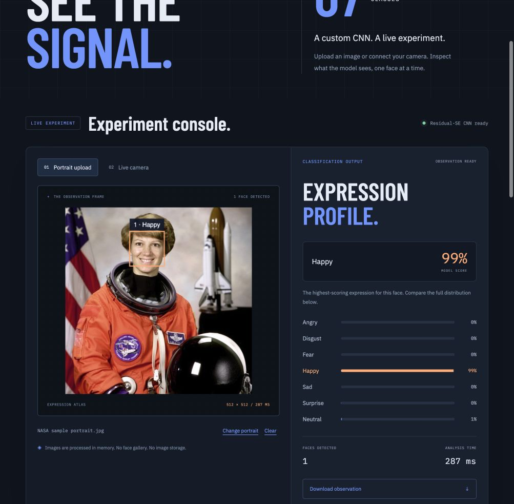

# Expression Atlas

A refined, interactive frontend for facial-expression recognition, built around a project-specific CNN trained from scratch by Nilay Srivastava. Bring a portrait, try the public-domain sample, or use a browser camera. Inspect face regions, compare all seven expression scores, switch between faces, and download an observation as JSON.

The original terminal-only project is preserved as a working CLI backed by the same inference service and preprocessing as the web app. No pretrained emotion-classification weights or simulated predictions are used. OpenCV’s Haar face detector is retained from the original project.



## Run the studio

Python 3.11 is recommended. The runtime uses lightweight ONNX inference, so TensorFlow is not required to run the website.

```bash
python3.11 -m venv .venv
source .venv/bin/activate
pip install -r requirements.txt
python run.py
```

Open **http://127.0.0.1:3350**. Camera access requires HTTPS or localhost and browser permission. The camera starts only after an explicit click, never accesses the microphone, and can be stopped or cancelled. If a browser does not surface its permission prompt, use portrait upload instead. Images are processed in memory and not stored.

## Terminal workflow

```bash
python emotion_detection.py --image path/to/portrait.jpg
python emotion_detection.py --image path/to/portrait.jpg --output observation.json
python emotion_detection.py --help
```

A desktop OpenCV window is optional: install `opencv-python==4.12.0.88` in a separate desktop environment instead of the headless build, then run `python emotion_detection.py --camera 0`. Press Q to exit. The browser interface works with the supplied headless runtime.

## Measured model results

The shipped model is a 2,976,991-parameter residual CNN with squeeze-and-excitation attention, trained **from random initialization**, on a free Colab T4. It completed 75 epochs with validation-based early stopping. The runtime includes horizontal-flip averaging, selected on validation data.

| Same held-out references | Baseline CNN | Residual-SE + FERPlus |
| --- | ---: | ---: |
| FERPlus crowd-label accuracy, 3,530 images | 67.59% | **83.60%** |
| FERPlus macro F1 | 0.586 | **0.701** |
| Original FER-2013 label accuracy, 3,589 images | **68.38%** | 60.35% |

FERPlus relabels the same source photographs using multiple annotators; it is not a larger or independent image dataset. The seven-class evaluation covers **98.36%** of PrivateTest. Unsupported contempt/unknown/non-face annotations are excluded, never reassigned. Original and crowd labels disagree on 35.5% of eligible test images. The improvement is against the crowd-label task, not a universal accuracy claim. The legacy baseline was trained before duplicate auditing, so this is a practical reference comparison rather than an isolated architecture ablation.

Read the [model card and full methodology](docs/model-card.md). The website displays its confusion matrix, per-class scores, both label protocols and data audit. Disgust recall is only 13.8%; this weakness is deliberately visible.

## Reproduce training

Use [`EmotionRecognition_FERPlus_Residual_Study.ipynb`](EmotionRecognition_FERPlus_Residual_Study.ipynb) in Google Colab with a **free T4**. Set `BASELINE_RUN` to your baseline checkpoint directory. The earlier [`baseline notebook`](EmotionRecognition_Train_From_Scratch.ipynb) can create it. The completed [Colab run](https://colab.research.google.com/drive/1SMh8u8DhKcUehvfSvKmqCBC2txaefCWb) includes both experiments; private [Drive artifacts](https://drive.google.com/drive/folders/19-WyPGtfIAsaxJ5EiC-PZUMr8lYmQr5x) preserve the checkpoints, history and export checks for the project owner.

The improved pipeline uses original Training/PublicTest/PrivateTest splits, exact-pixel duplicate auditing, soft vote distributions, mild augmentation, balanced sample weights, AdamW and a cosine learning-rate schedule. Input remains 48×48 grayscale with normalization embedded. It removes 684 training/held-out overlaps, merges 1,053 training duplicates and removes 46 validation/test overlaps. Exact duplicate leakage after cleaning is zero; person-level and near-duplicate independence are not established.

Local training is optional:

```bash
pip install -r requirements-training.txt
python train_model.py --data data --output models/baseline --epochs 65
python training_improved.py --baseline-dir models/baseline --output models/improved --epochs 100
python scripts/export_model.py models/improved
```

Copy the verified ONNX, configuration, metrics, comparison and audit files to `models/`, then restart. The committed ONNX is ready to run; TensorFlow is needed only for training or checkpoint conversion. Keras/H5 checkpoints and test-image parity batches remain in the owner's Drive rather than Git.

## API and tests

- `GET /api/health`: model readiness, class order and measured evaluation metadata.
- `GET /api/evaluation`: full measured reports, baseline comparison and duplicate audit.
- `POST /api/analyze`: JPEG, PNG or WebP bytes with the matching Content-Type; returns image dimensions, face boxes, seven-class scores and measured latency. Eight-megabyte upload and 16-megapixel image limits apply.

```bash
pip install -r requirements-dev.txt
python -m pytest -q
node --check static/app.js
```

The tests cover image decoding, face detection, empty inputs, invalid formats, size limits, no-face results, runtime input dimensions and class order, and HTTP security/cache headers. Deployment verification also compares the converted model numerically with the original Keras test predictions.

## Interpret with care

This is a computer-vision portfolio and research demonstration. The labels describe visible facial-expression classes; they do not establish what someone feels. Model scores are not calibrated certainty. Pose, lighting, occlusion and dataset differences affect results.

See [initial audit](docs/initial-audit.md), [design direction](docs/design-direction.md), and [asset/model credits](docs/asset-credits.md). Historical README accuracy and FPS figures were removed because the repository did not include evidence supporting them; current results come from the saved, held-out evaluation.

See the [verification record](docs/verification.md) for completed checks and the public-deployment status.
