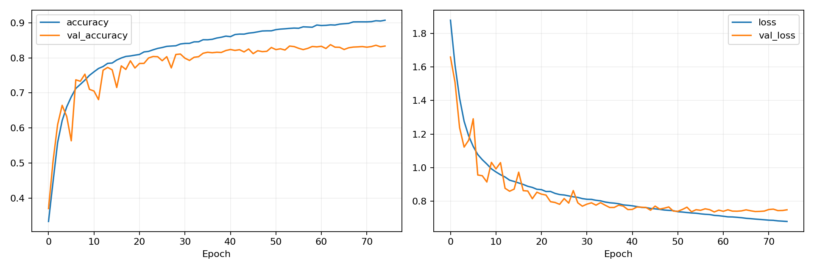
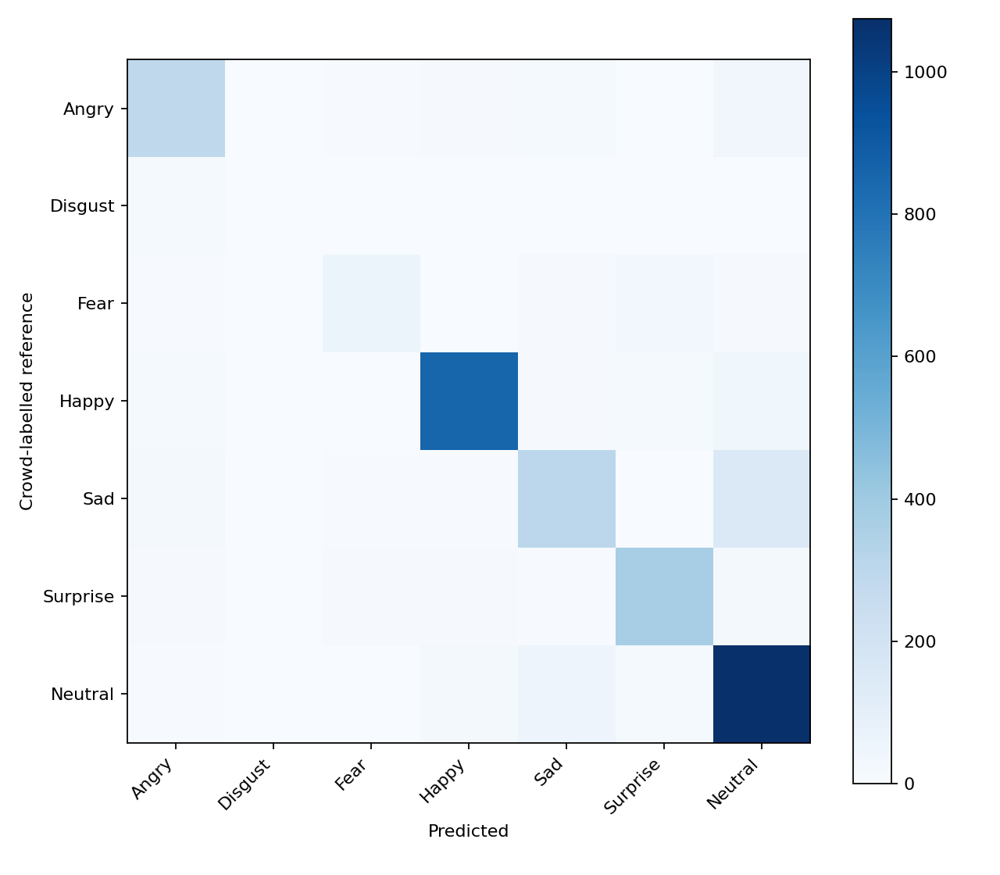

# Expression Atlas — model card

## Purpose and provenance

A portfolio experiment in seven-class visible facial-expression classification. The classifier is a project-specific implementation trained from scratch by an automated Colab run for Nilay Srivastava on 26 November 2026. No external pretrained emotion-classification weights or transfer-learning backbone are used. The standard OpenCV Haar cascade only locates faces. Residual connections and squeeze-and-excitation are established architectural techniques, not claimed as novel research.

## Data and preprocessing

Original FER-2013 CSV pixels are retrieved from the public `deadskull7/fer2013` Kaggle mirror. FERPlus crowd votes are pinned to Microsoft's annotation commit `ae2128abf776409c93e50cf7c9d87180673314e6`. Annotation and archive SHA-256 values are in `models/data-audit.json`. Row count and Usage alignment are checked before combining data; image filenames are not treated as row indices. Source rights and original dataset terms continue to apply; this repository does not redistribute the training images.

The seven output classes, in order, are Angry, Disgust, Fear, Happy, Sad, Surprise, Neutral. Retain at least six votes among supported classes and at most four outside them; normalize retained votes into soft targets. Excluded votes are not relabelled. Exact raw-pixel hashes remove training overlaps with either held-out split, merge duplicate training votes and remove validation overlaps with test. Final sizes: 26,529 training, 3,464 validation, 3,589 original test images. FERPlus evaluation retains 3,530 test images (98.36%). The model sees 48×48 grayscale pixels in [0,255]; rescaling is part of its graph.

This checks exact duplication, not identity-disjointness or perceptual near-duplicates. Source demographic balance and representativeness have not been established.

## Training and selection

Custom residual/SE network: four stages, two blocks per stage, average/max pooling, dense head; 2,976,991 parameters. Random initialization, seed 2026. Horizontal flip, small rotation and translation; no vertical flips. Soft-label cross entropy and clipped mild class-balance sample weighting; AdamW with warmup and cosine decay, dropout, batch normalization and weight decay. Best validation loss selects the checkpoint; early stopping after 75 of at most 100 epochs. Training plus evaluation took about 839 seconds on a free Colab T4.

Horizontal-flip averaging was chosen using validation accuracy plus macro F1 (single: 83.26% / 0.708; flip averaging: 83.31% / 0.711). Test performance was not used to select that option. Only one improved residual training run was completed; the earlier failed attempt stopped before training because of an overly strict annotation filename guard.

## Held-out results and limits

| PrivateTest evaluation | Baseline | Improved |
| --- | ---: | ---: |
| Crowd-label accuracy, 3,530 eligible images | 67.59% | 83.60% |
| Crowd-label macro F1 | 0.586 | 0.701 |
| Original-label accuracy, all 3,589 images | 68.38% | 60.35% |
| Original-label macro F1 | 0.657 | 0.495 |

The baseline predates deduplication. Both models are scored on identical references, but data policy, annotation targets, architecture and optimization all change; this is not a controlled architecture-only ablation. On 35.5% of eligible test images, the original hard label differs from the FERPlus majority. The old combined-test baseline result of 66.48% is a different evaluation and must not be subtracted from 83.60% as an improvement figure.

Improved crowd-label balanced accuracy is 67.58%. Disgust recall is 13.79% (29 reference examples), and Fear recall is 47.41%; these minority categories need further work. A separately reported high-consensus subset reaches 92.46%, but covers only 75.79% of test and is **not** the headline result. Scores are uncalibrated model outputs, not reliable probabilities of someone's internal feelings.

Full results: `models/metrics.json`, `models/comparison.json`, learning curves and confusion matrix. No confidence interval, repeated-seed variance, independent external-dataset benchmark or demographic fairness evaluation is claimed. A useful next experiment is a prespecified minority-class objective with repeated seeds and a separate external test set, rather than tuning repeatedly on this test.

## Runtime and verification

ONNX opset 17, CPU inference; no TensorFlow required for serving. SHA-256: `f5773fae1cc6679d2dc0b1d2a7ea01130ce51fb2dcc4598b646edaba5df1764b`. On 16 held-out inputs, ONNX and Keras agree on every top class; max absolute score difference 0.00000215, full flip-averaged pipeline difference 0.00000143. Runtime preprocessing uses the same size, label order and embedded normalization.

The server detects a maximum of eight faces, bounds image size, and returns all seven scores plus simple lighting/focus/size flags. Webcam frames are sent only to the app's analysis server, processed in memory, and not stored. Camera use is explicit and stoppable. Haar localization can miss tilted, occluded or profile faces. Benchmark face crops do not measure end-to-end webcam accuracy.

## Responsible presentation

Use for an opt-in demonstration of visible expression patterns. It cannot establish emotion, intent, truthfulness, mental health or suitability for employment, education, healthcare or access decisions. Real-world pose, lighting, appearance and camera changes can degrade performance. This is a research/portfolio system with published weaknesses, not a validated emotion measurement instrument.

## Sources

- [Microsoft FERPlus annotations and methodology](https://github.com/microsoft/FERPlus)
- [Training with crowd label distributions](https://arxiv.org/abs/1608.01041)
- [Original CSV mirror](https://www.kaggle.com/datasets/deadskull7/fer2013)

